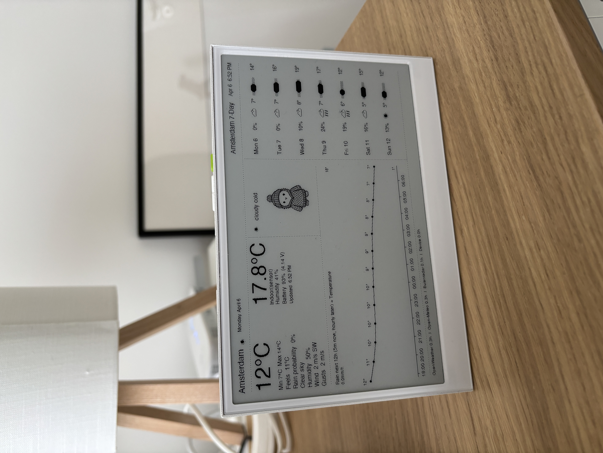
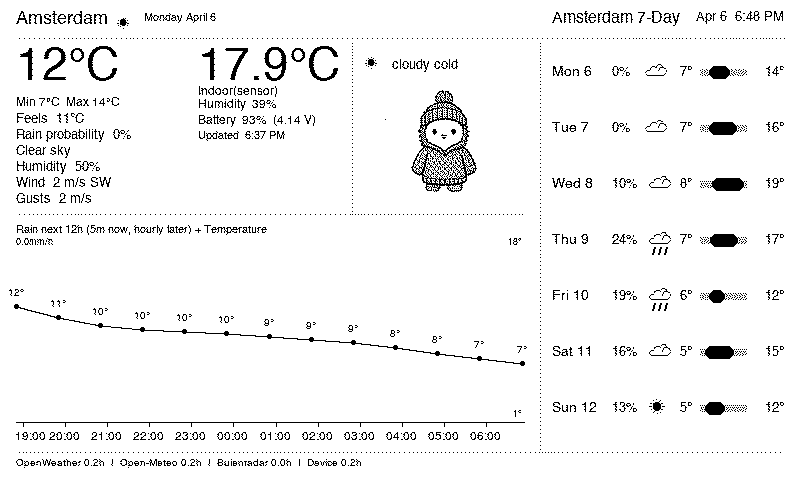

# weather-server

99% vibe coded

Weather dashboard project for an e-ink display. The repo contains a Python server that renders weather images and an Arduino sketch for the display device that downloads and shows them.

<table><tr><td></td><td></td></tr></table>


## Repository layout

- `flask-server/` Python HTTP server that fetches weather data, caches it in SQLite, renders the dashboard image, and exposes API endpoints for the display client.
- `arduino-reterminal/weather_display/` Arduino sketch for the reTerminal E1001. It reads the on-board SHT40 sensor, posts sensor data to the server, downloads `/dashboard.bin`, and deep-sleeps between refreshes.
- `arduino-lilygo/battery_monitor/` Battery-monitor sketch for the LilyGO T5 display.
- `Dockerfile` Container image definition for the Python server.

## Flask server

Run locally:

```bash
cd flask-server
python3 -m unittest test.py
python3 app.py
```

The server listens on port `8080` by default and exposes:

- `GET /up`
- `GET /dashboard.png`
- `GET /dashboard.bin`
- `GET /refresh`
- `GET /force-refresh-sources`
- `GET /api/setup`
- `GET /api/display`
- `POST /sensor`

The HTTP listener handles requests concurrently. Client sockets are closed after
10 seconds without progress, and `/sensor` bodies are limited to 1 KiB. This
keeps an interrupted upload from a browning-out display from blocking the whole
server.

Key configuration lives in `flask-server/local_settings.py` or `WEATHER_*` environment variables:

- `CITY` is used as the displayed city label and as the cache key for that location.
- `CITY_LAT` and `CITY_LON` are used for Open-Meteo and Buienradar and must match the same place as `CITY`.
- `BASE_URL` is required for normal operation.

`CITY` supports these formats when you want to disambiguate a place name:

- `City`
- `City,CC`
- `City,State,CC`

Examples: `Amsterdam`, `Amsterdam,NL`, `Portland,OR,US`. No camel case is required. Prefer `City,CC` when the name could be ambiguous.

The rendered dashboard now uses Open-Meteo for current conditions, daily min/max values, and the temperature plot. Buienradar is only used for short-range rain detail in the Netherlands and Belgium.

The [independent rain-chart audit](docs/rain-validation.md) captures dashboard
images and provider responses over 24 hours, checks plotted intervals and units,
and separates plotting errors from ordinary forecast updates.

For rain, Buienradar has priority over every interval its short-term feed
covers, including a dry forecast. Open-Meteo fills gaps and the longer range
using overlap-weighted precipitation over its preceding-hour accumulation
periods. Missing coverage is marked as unavailable, not converted to zero.
Rain-axis labels and bar heights share the same scale.

The validator is opt-in via `compose.rain-validation.yml`; it is not a background
part of the dashboard. Its [reuse instructions](docs/rain-validation.md#run-another-audit-on-the-nas)
explain how to start a bounded audit and remove its container without deleting evidence.

The weather cache is stored in `flask-server/weather_cache.sqlite3`. Weather-source history is partitioned by normalized city so one database can keep cached data for multiple locations.

## Mascot selection logic

The hedgehog in the center panel is picked by a small fixed rule cascade in `flask-server/app.py`.

Meaning of the rule words:


Compact view of the logic:

```text
if snowy:
   snow
elif freezing and windy and not rainy:
   freezing_windy
else:
   temp_variant = "warm" if warm else "cold"
   if rainy:
      rainy_<temp_variant>
   elif sunny:
      sunny_<temp_variant>
   else:
      cloudy_<temp_variant>
```

These thresholds are configurable in `config.py` and can be overridden by `local_settings.py` or environment variables.

```python
CHARACTER_RULES = _structured_setting(
    "CHARACTER_RULES",
    {
      "warm_temp_c": 16.0, # above this is considered warm, below is cold
      "freezing_temp_c": 2.0, # at or below this is considered freezing for the purpose of the freezing_windy rule
      "windy_speed_mps": 10.0, # at or above this is considered windy for the purpose of the freezing_windy rule
      "rain_prob_percent": 35, # at or above this is considered high rain probability for the rainy rule
    },
)
```

Container publishing:

- Pushes to `main` build the root `Dockerfile` and publish `ghcr.io/pabloazurduy/weather-server` through GitHub Actions.
- Pull requests build the same image without publishing so Dockerfile changes stay validated.

Run with Docker:

```bash
docker build -t weather-dashboard .
docker run -p 8080:8080 \
   -e WEATHER_CITY=Amsterdam,NL \
   -e WEATHER_CITY_LAT=50.1 \
   -e WEATHER_CITY_LON=4.0 \
   -e WEATHER_BASE_URL=http://your-host:8080 \
   weather-dashboard
```

Or pull the published image:

```bash
docker pull ghcr.io/pabloazurduy/weather-server:latest
```

## Arduino sketches

For the production display sketch:

1. Copy `arduino-reterminal/weather_display/secrets.example.h` to `arduino-reterminal/weather_display/secrets.h`.
2. Fill in Wi-Fi credentials and the server host/port.
3. Install the libraries referenced at the top of `arduino-reterminal/weather_display/weather_display.ino`.
4. Build and flash from the Arduino IDE for `XIAO_ESP32S3` with PSRAM enabled.

### reTerminal recovery and offline display

An e-paper panel keeps its last image without power, so an unchanged screen does
not by itself mean the board is frozen. Connect the carrier USB serial port at
115200 baud to see each wake cycle and the exact Wi-Fi/HTTP error.

The production sketch supports manual recovery and keeps the forecast visible
during network outages:

- All three top buttons (GPIO3, GPIO4, and GPIO5) are RTC wake sources with
  pull-ups that remain enabled during deep sleep. Any button wakes and refreshes.
- Each complete, successful dashboard download is saved to flash with an
  integrity checksum. The cached forecast survives deep sleep and restarts.
- If Wi-Fi or the server becomes unavailable, the last forecast stays visible
  with a small `Connection lost` badge in the bottom-right footer. The badge is
  drawn once per outage; the device retries every 15 minutes or on a button press.
- A successful refresh replaces the cached forecast and removes the badge. If
  there is no usable cache yet, the existing panel image is left untouched.
- Server requests allow 45 seconds for a response, covering the measured delay
  when the NAS has to fall back to cached weather after failed upstream lookups.

Keep the board's `Default with spiffs` partition scheme enabled for the local
LittleFS forecast cache. On first use the sketch initializes the filesystem only
if that partition is completely erased. Existing filesystems that cannot be
mounted are left untouched; without a usable cache, failures still preserve the
panel image but cannot add the badge.

The [offline recovery hardware test](arduino-reterminal/tests/offline_recovery/README.md)
checks cache integrity, interrupted saves, deep sleep, outage handling, and normal
recovery on a connected reTerminal without disconnecting the NAS.

After a complete battery discharge, charge for a few minutes with the rear power
switch on, then press any top button to wake and refresh it. If the protection
circuit has completely powered it off, toggle the rear power switch off and on
once before pressing a top button.
